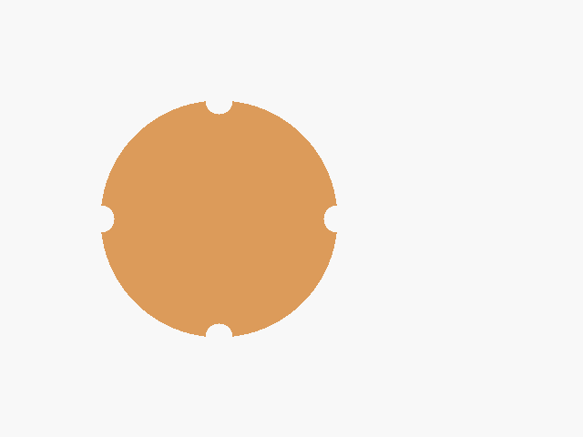
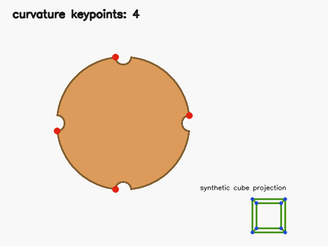

# Pose Estimation Lab

A small, standalone demonstration of contour curvature, geometric keypoint selection, rigid camera transforms, and pinhole projection using Python, OpenCV, and NumPy.

The examples use synthetic data and do not require a simulator or external SDK.

## Run

```css
python -m pip install -r requirements.txt
python -m unittest discover -s tests -v
python src/visualization.py
```

The last command regenerates `examples/sample_input.png` and `examples/sample_output.png`.

## Examples

**Input**



**Output**



The input is a synthetic circular mask with shallow notches. The output shows selected contour keypoints and a projected wireframe cube.

## Modules

- `src/contour_keypoints.py`: External contour extraction, local turning-angle curvature, fixed/adaptive/multi-level selection, and spatial suppression. The selection workflow is adapted from the Apache-2.0 detector noted in `NOTICE`.
- `src/camera_geometry.py`: Rigid 4×4 transforms, inverse transforms, focal-length calibration from vertical field of view, and pinhole projection. Camera coordinates use +X right, +Y down, +Z forward.
- `src/visualization.py`: Deterministic synthetic examples.

## Coordinate Convention

Points are row-wise XYZ in camera coordinates, and distances use consistent units (meters are conventional). Camera intrinsics are expressed in pixels. Points with non-positive camera Z are returned as NaN because they are not in front of the camera.

## License

Original code and synthetic examples are released under the MIT License (see `LICENSE`). Portions of the keypoint selection workflow are adapted from Apache-2.0 licensed code; see `NOTICE` for attribution and applicable terms.
